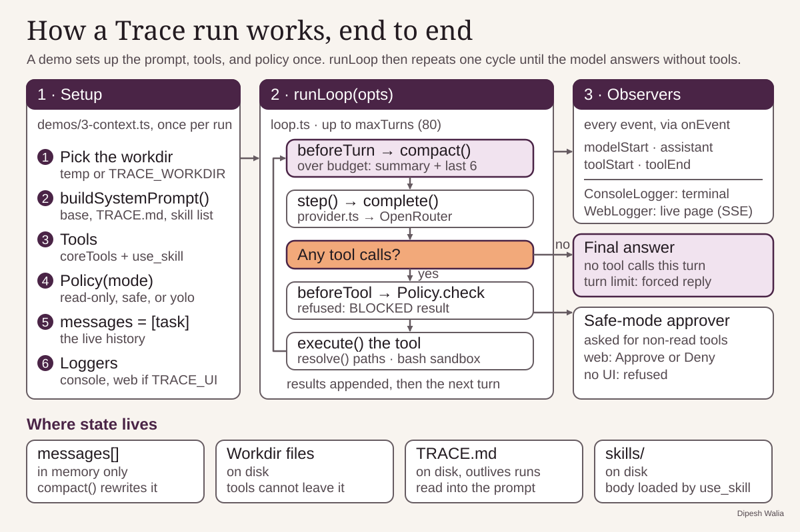
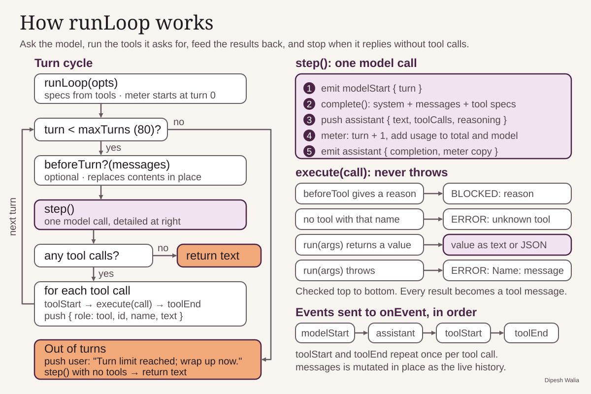
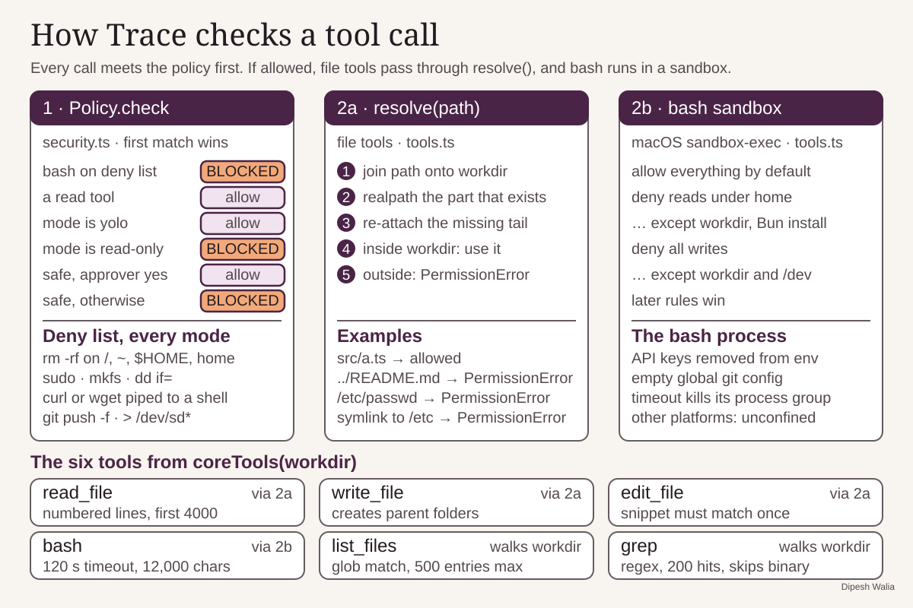
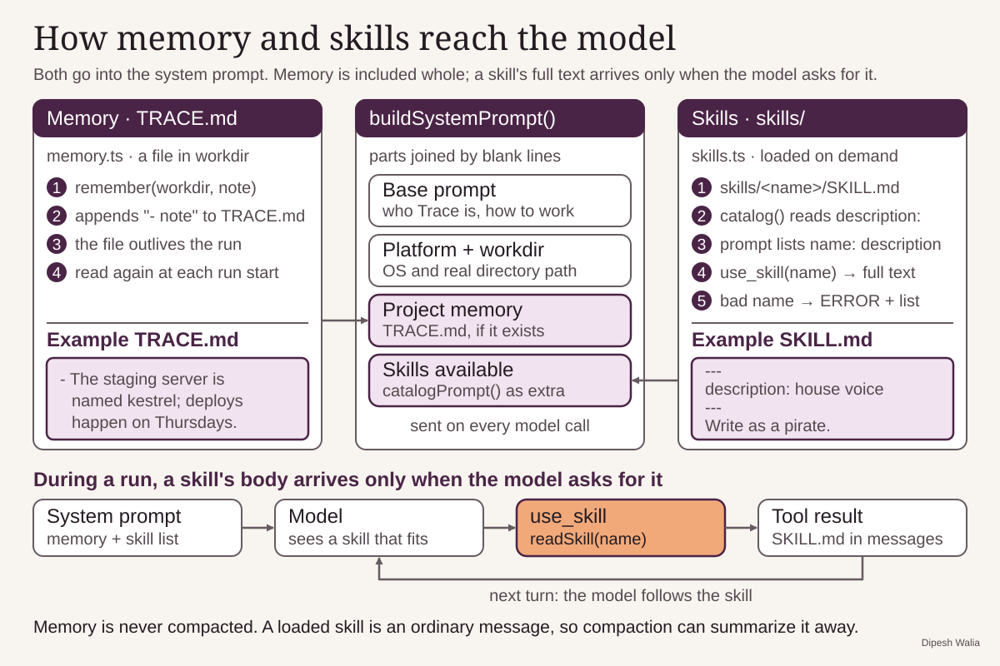
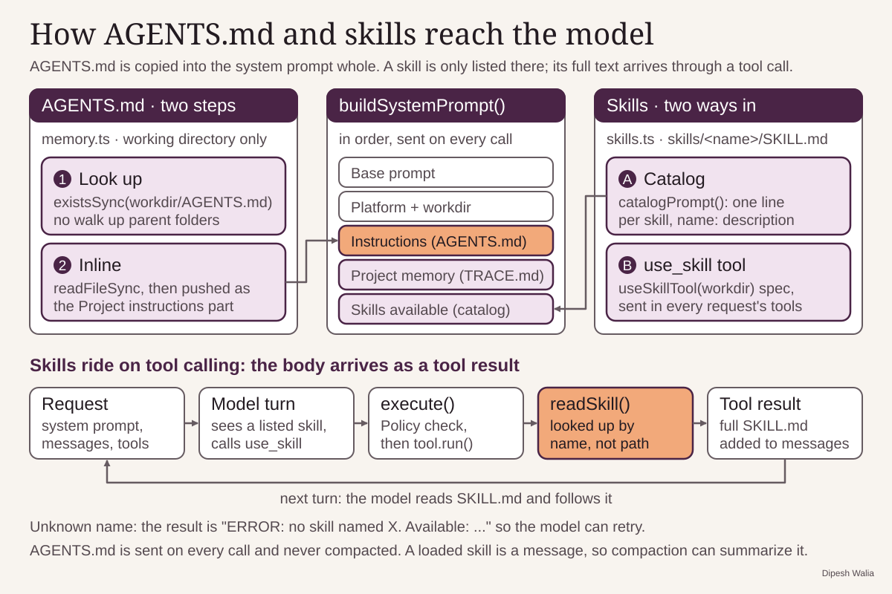
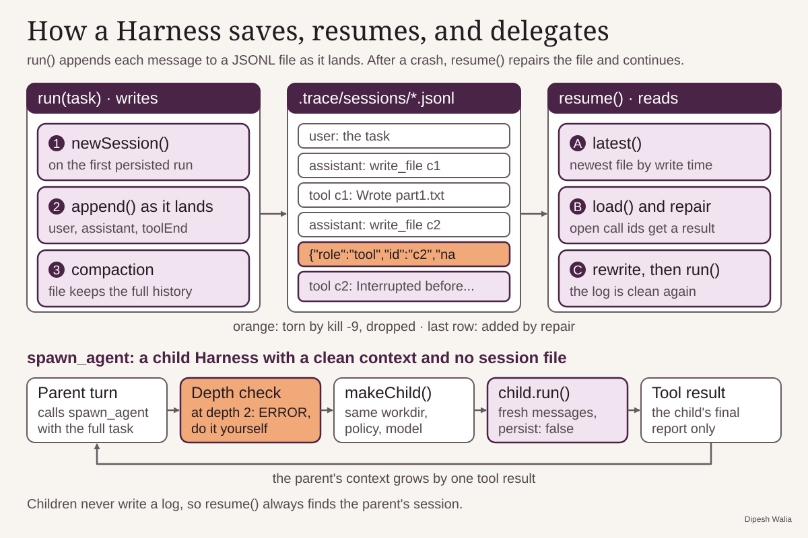

# Trace

A small agent harness in TypeScript on Bun. It talks to models through OpenRouter.

## Setup

```sh
bun install
export TRACE_API_KEY=...   # an OpenRouter key; OPENROUTER_API_KEY also works
```

Set `TRACE_MODEL` to use a model other than the default in `trace/provider.ts`.

## Demos

```sh
bun demos/1-dice.ts [basic | bad-args | parallel | turn-limit]
bun demos/2-build.ts [fib | delete-home | delete-folder | escape]
bun demos/3-context.ts [compact | remember | skill | learn | recall | agents | commit]
bun demos/4-harness.ts [crash | resume | delegate]
```

With no argument, each demo lists its scenarios and asks which one to run.

`learn` and `recall` share `scratch/memory/TRACE.md`, so memory survives
between runs. `learn` asks what to remember and `recall` asks what to ask;
you can also pass the text as an argument. To see it work, run `recall`
before and after `learn`. `recall` gets no tools, so the model can only know
the answer from `TRACE.md` in its system prompt:

```sh
rm -rf scratch/memory
bun demos/3-context.ts recall "What is my dog's name?"   # does not know
bun demos/3-context.ts learn "My dog is called Biscuit"  # the model calls remember
bun demos/3-context.ts recall "What is my dog's name?"   # answers Biscuit
```

Press Enter at a prompt to use the built-in example instead.

An [AGENTS.md](https://agents.md/) in the working directory goes into the
system prompt next to `TRACE.md`. `agents` works in `scratch/agents/`. If
`AGENTS.md` is missing there, it writes an example with a test database port
and a release approver. If the file already exists, it uses it as it is.
Then it asks a new session with no tools your question, or one about the
example. Edit `scratch/agents/AGENTS.md` and ask about what you added:

```sh
bun demos/3-context.ts agents "What is the staging bucket?"
```

`commit` writes a commit message for `demos/fixtures/remember-tool.diff`
twice: once with `demos/skills/commit-message` in the folder and once
without. Both messages are kept, in
`scratch/skill-compare/<time>/with/COMMIT_MSG.txt` and
`scratch/skill-compare/<time>/without/COMMIT_MSG.txt`, and printed side by
side. Each run gets a new `<time>` folder, so earlier runs are kept.

`4-harness.ts` works in `scratch/harness/`. A `Harness` writes every message
to a session file in `.trace/sessions/` as soon as it arrives. To see a
crash and a resume, run `crash`. After `part2.txt` appears and before
`SUMMARY.md` does, stop it with `kill -9`. Then run `resume`. It loads the
latest session, adds a notice for any tool call the kill interrupted, and
finishes the task:

```sh
bun demos/4-harness.ts crash     # kill -9 the printed pid partway
bun demos/4-harness.ts resume    # all six files exist at the end
```

`delegate` has two sub-agents write `utils.ts` and `test_utils.ts`, and the
parent runs the tests itself. Sub-agents keep no session file, so
`.trace/sessions/` holds only the parent's. `crash` and `delegate` empty
`scratch/harness/` first, unless `TRACE_WORKDIR` is set.

`2-build.ts` gives the agent files and a shell, confined to a fresh folder
under the system temp directory; the path is printed as `workdir:`. To keep
the files somewhere easy to find, set `TRACE_WORKDIR`:

```sh
TRACE_WORKDIR=./scratch bun demos/2-build.ts fib
bun scratch/fib.ts
```

`scratch/` is ignored by git.

## Layout

- `trace/provider.ts`: the only code that talks to OpenRouter.
- `trace/loop.ts`: the agent loop. It asks the model, runs tools, and feeds results back.
- `trace/logger.ts`: prints loop events with colors, a spinner, and usage and cost.
- `trace/tools.ts`: the core tools (files, edits, shell, search), confined to a working directory.
- `trace/security.ts`: the policy that blocks dangerous tool calls.
- `trace/context.ts`: compacts old messages into a summary when history goes over a token budget.
- `trace/memory.ts`: builds the system prompt, reads `AGENTS.md`, and keeps project notes in `TRACE.md`.
- `trace/skills.ts`: finds skills in `skills/<name>/SKILL.md` and gives the model a `use_skill` tool.
- `trace/session.ts`: saves each message to a JSONL file and repairs the file after a crash.
- `trace/subagent.ts`: the `spawn_agent` tool, which runs a task in a fresh child harness.
- `trace/harness.ts`: the `Harness` class, which puts all of the above together for one working directory.
- `trace/index.ts`: the public API: `Harness`, `Policy`, `tool`, and the `Tool` type.
- `trace/cli.ts`: the `bun run trace` entry point; a stub until step 6.
- `demos/`: runnable examples.

## Docs

- [How a Trace run works, end to end](docs/end-to-end.svg): setup in a demo, the `runLoop` cycle with compaction and the policy check, the observers, how a run ends, and where state lives.



- [How runLoop works](docs/runloop.svg): the turn cycle, `step()`, `execute()`, and the events the loop emits.



- [How Trace checks a tool call](docs/tool-guards.svg): `Policy.check`, the `resolve()` path guard, the bash sandbox, and the six core tools.



- [How memory and skills reach the model](docs/memory-skills.svg): `remember()` and `TRACE.md`, the parts of `buildSystemPrompt()`, the skill catalog, and how `use_skill` loads a skill during a run.



- [How AGENTS.md and skills reach the model](docs/agents-skills.svg): the two steps that load `AGENTS.md` into the system prompt, the two ways a skill enters a run, and how `use_skill` delivers a skill's text as a tool result.



- [How a Harness saves, resumes, and delegates](docs/harness-sessions.svg): how `run()` appends each message to a session file, how `resume()` drops a torn line and answers interrupted tool calls by id, and how `spawn_agent` runs a task in a child harness that keeps no session file.


