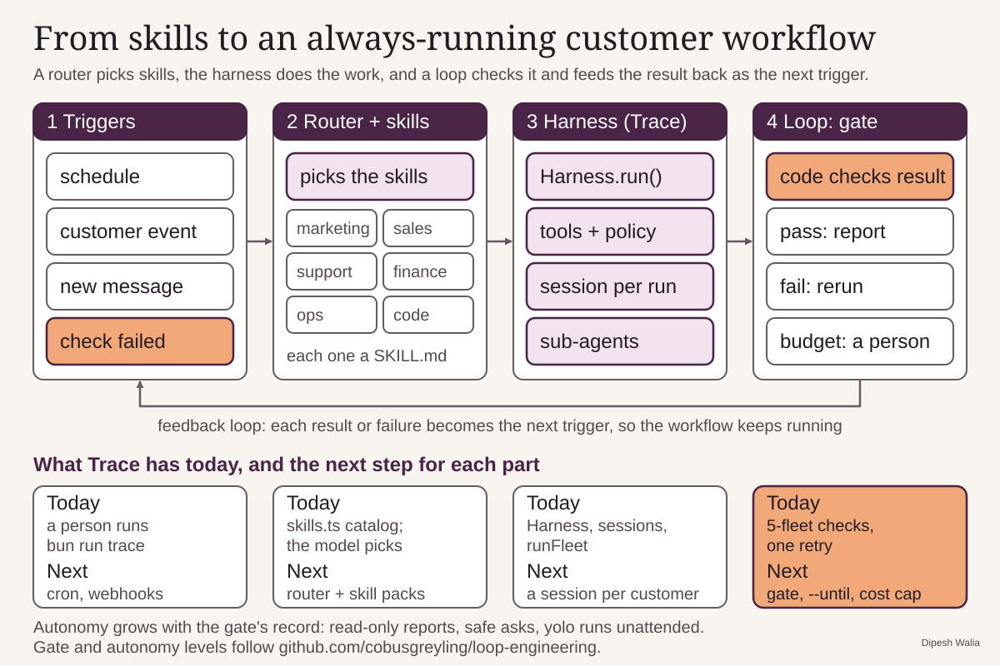
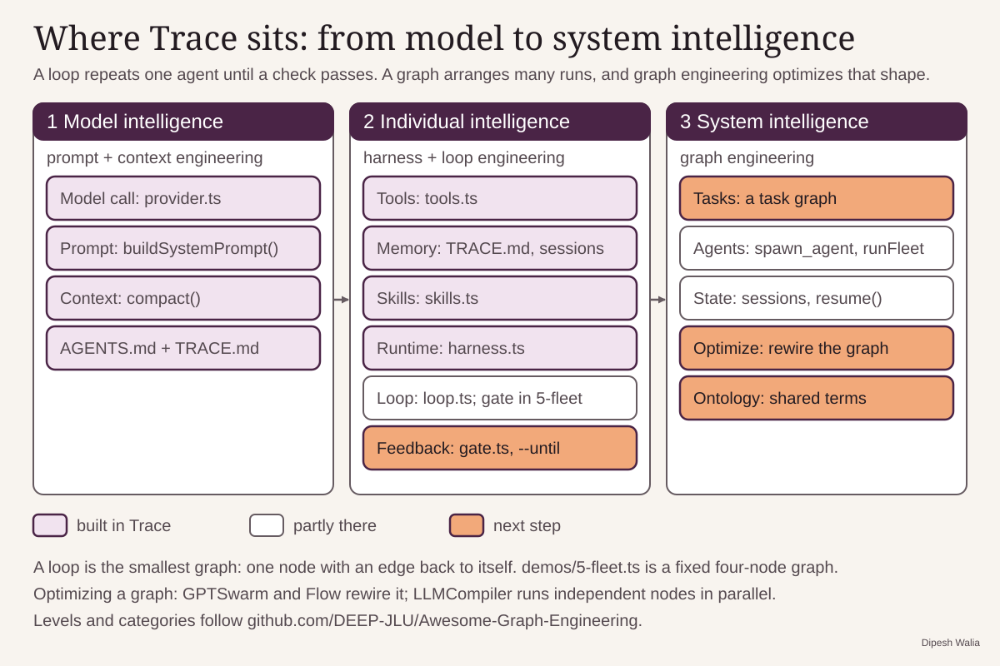
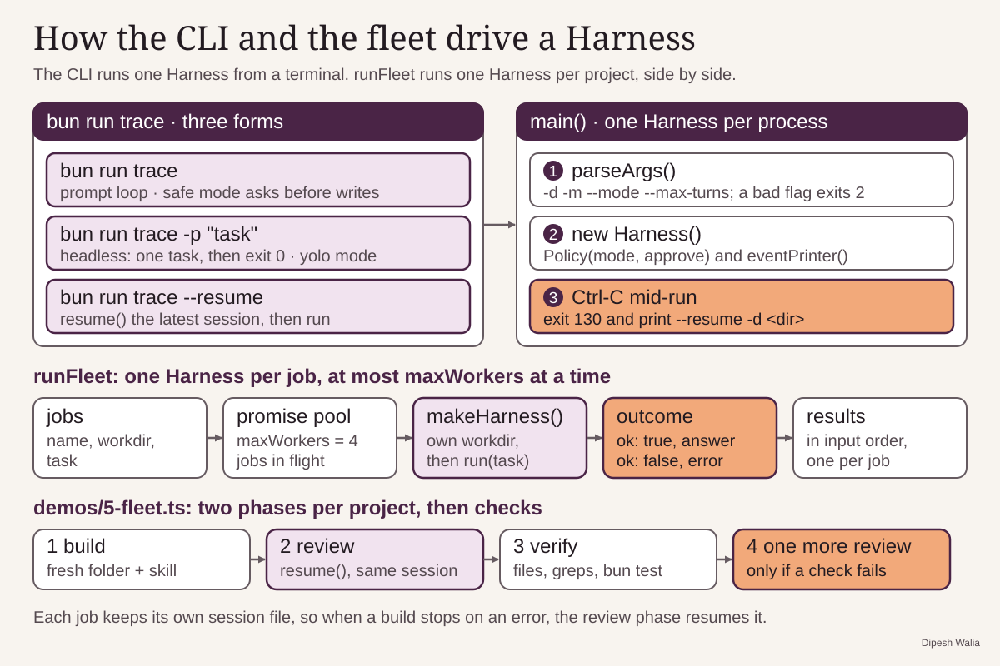

# Trace

Trace is a small agent harness in TypeScript on Bun. Each concept lives in
its own file under `trace/`: the model call, the loop, tools, safety,
context, memory, skills, sessions, sub-agents, and a fleet runner. It has no
runtime dependencies beyond Bun and talks to models through OpenRouter.

## Setup

```sh
bun install
export TRACE_API_KEY=...   # an OpenRouter key; OPENROUTER_API_KEY also works
```

Set `TRACE_MODEL` to use a model other than the default in `trace/provider.ts`.

## Run it

```sh
bun run trace                        # interactive prompt loop in the current folder
bun run trace -p "add a test for x"  # run one task headless, then exit
bun run trace --resume               # continue the latest session in the folder
```

The agent works only inside its folder, called the jail. `-d` sets it (the
default is `.`). `-m` picks the model and `--max-turns` caps each task
(default 120). `--mode` is `read-only`, `safe`, or `yolo`. Interactive runs
default to `safe`, which asks `approve ...? [y/N]` before each write or
shell command. Headless runs default to `yolo`, where only the deny list,
the path check, and the bash sandbox apply. Every message goes to
`.trace/sessions/` as it arrives. If you press Ctrl-C during a run, the
session is kept, and `--resume` picks it up.

## Use it from code

A `Harness` puts the parts together for one folder. Pass your own tools in
`extraTools`:

```ts
import { Harness, Policy, tool } from "./trace/index.ts";

const wordCount = tool({
  name: "word_count",
  description: "Count the words in a piece of text",
  params: { text: { description: "The text to count" } },
  run: ({ text }) => String(String(text).split(/\s+/).filter(Boolean).length),
});

const harness = new Harness({ workdir: "scratch/demo", policy: new Policy("yolo"), extraTools: { word_count: wordCount } });
console.log(await harness.run("How many words are in 'the quick brown fox'? Use word_count."));
```

`runFleet(jobs, makeHarness, maxWorkers)` runs many such harnesses at once
and returns one `{ name, ok, report }` per job, in input order.

## Demos

```sh
bun demos/1-dice.ts [basic | bad-args | parallel | turn-limit]
bun demos/2-build.ts [fib | delete-home | delete-folder | escape]
bun demos/3-context.ts [compact | remember | skill | learn | recall | agents | commit]
bun demos/4-harness.ts [crash | resume | delegate]
bun demos/5-fleet.ts [all | artisan-coffee | taskman | viper | review | verify]
```

With no argument, each demo lists its scenarios and asks which one to run.

`learn` and `recall` share `scratch/memory/TRACE.md`, so memory survives
between runs. `learn` asks what to remember and `recall` asks what to ask;
you can also pass the text as an argument. To see it work, run `recall`
before and after `learn`. `recall` gets no tools, so the model can only know
the answer from `TRACE.md` in its system prompt:

```sh
rm -rf scratch/memory
bun demos/3-context.ts recall "What is my dog's name?"   # does not know
bun demos/3-context.ts learn "My dog is called Biscuit"  # the model calls remember
bun demos/3-context.ts recall "What is my dog's name?"   # answers Biscuit
```

Press Enter at a prompt to use the built-in example instead.

An [AGENTS.md](https://agents.md/) in the working directory goes into the
system prompt next to `TRACE.md`. `agents` works in `scratch/agents/`. If
`AGENTS.md` is missing there, it writes an example with a test database port
and a release approver. If the file already exists, it uses it as it is.
Then it asks a new session with no tools your question, or one about the
example. Edit `scratch/agents/AGENTS.md` and ask about what you added:

```sh
bun demos/3-context.ts agents "What is the staging bucket?"
```

`commit` writes a commit message for `demos/fixtures/remember-tool.diff`
twice: once with `demos/skills/commit-message` in the folder and once
without. Both messages are kept, in
`scratch/skill-compare/<time>/with/COMMIT_MSG.txt` and
`scratch/skill-compare/<time>/without/COMMIT_MSG.txt`, and printed side by
side. Each run gets a new `<time>` folder, so earlier runs are kept.

`4-harness.ts` works in `scratch/harness/`. A `Harness` writes every message
to a session file in `.trace/sessions/` as soon as it arrives. To see a
crash and a resume, run `crash`. After `part2.txt` appears and before
`SUMMARY.md` does, stop it with `kill -9`. Then run `resume`. It loads the
latest session, adds a notice for any tool call the kill interrupted, and
finishes the task:

```sh
bun demos/4-harness.ts crash     # kill -9 the printed pid partway
bun demos/4-harness.ts resume    # all six files exist at the end
```

`delegate` has two sub-agents write `utils.ts` and `test_utils.ts`, and the
parent runs the tests itself. Sub-agents keep no session file, so
`.trace/sessions/` holds only the parent's. `crash` and `delegate` empty
`scratch/harness/` first, unless `TRACE_WORKDIR` is set.

`5-fleet.ts` uses `runFleet` to build three projects side by side, each in
its own folder under `scratch/fleet/`. `artisan-coffee` is a coffee roaster
landing page, `taskman` is a task manager CLI with a `bun test` suite, and
`viper` is a canvas snake game. Each folder gets a `design-engineering`
skill that sets the quality bar. After the build, a second phase resumes the
same session for a design-director review. Mechanical checks then decide
pass or fail, such as `bun test` for taskman and a count of visible words
for the landing page. A project that fails gets one more review pass, and
the run ends with a results table. `review` runs another pass on projects
already built, and `verify` only checks them:

```sh
bun demos/5-fleet.ts all              # build, review, check; takes several minutes
bun demos/5-fleet.ts review viper     # one more review pass on one project
bun demos/5-fleet.ts verify           # checks and the results table, no model calls
```

`2-build.ts` gives the agent files and a shell, confined to a fresh folder
under the system temp directory; the path is printed as `workdir:`. To keep
the files somewhere easy to find, set `TRACE_WORKDIR`:

```sh
TRACE_WORKDIR=./scratch bun demos/2-build.ts fib
bun scratch/fib.ts
```

`scratch/` is ignored by git.

## Anatomy

Each stage added a few files to `trace/` and one demo that checks them.

| Stage | Files added | What it adds |
| --- | --- | --- |
| 1. Loop | `provider.ts`, `loop.ts`, `logger.ts` | One request function for OpenRouter. The turn cycle: ask the model, run the tools it calls, feed results back. Colored logs with usage and cost. Demo: `1-dice.ts`. |
| 2. Tools | `tools.ts`, `security.ts`, `web.ts` | Six core tools (read, write, edit, bash, list, grep) confined to one folder. A policy with a deny list and three modes. A live web view. Demo: `2-build.ts`. |
| 3. Context | `context.ts`, `memory.ts`, `skills.ts` | Compaction when history goes over a token budget. The system prompt with `AGENTS.md` and `TRACE.md` memory. Skills loaded on demand with `use_skill`. Demo: `3-context.ts`. |
| 4. Harness | `session.ts`, `subagent.ts`, `harness.ts`, `index.ts` | JSONL sessions with crash repair. The `spawn_agent` tool. The `Harness` class that puts it all together. The public API. Demo: `4-harness.ts`. |
| 5. Product | `cli.ts`, `fleet.ts` | The `bun run trace` command line (headless, interactive, resume) and `runFleet`, which runs many harnesses at once. Demo: `5-fleet.ts`. |

## Next steps: loop and graph engineering

### Loop engineering

Trace is the harness: one agent that can work safely, save its session, and
pick up where it stopped. Loop engineering is the layer on top. A loop
finds work, gives it to the harness, checks the result with code, and
either reports the result, feeds the failure back for another run, or hands
the work to a person when the budget is spent. Add a router that picks from
a library of skills, such as marketing, sales, support, finance, ops, and
code, and the workflow keeps running for each customer, with every result
or failure starting the next run.



What Trace has today, and the next step for each part:

- Triggers: today a person runs `bun run trace`. Next is a schedule (cron)
  and webhooks that call `bun run trace -p`.
- Router and skills: today `skills.ts` lists the skills and the model picks
  one with `use_skill`. Next is an explicit router and packs of skills.
- Harness: today `Harness`, sessions, and `runFleet`. Next is one long-lived
  session per customer.
- Gate: today only `demos/5-fleet.ts` checks results, with one extra review
  pass. Next is a reusable `trace/gate.ts` that reads checks from a file, a
  `--until` option that reruns a task until the gate passes, and a cost cap,
  since the meter in `loop.ts` already tracks cost.

Autonomy should grow with the gate's record: `read-only` to report,
`safe` to ask before acting, and `yolo` only once the gate has been right
for a while. The gate and the autonomy levels follow
[cobusgreyling/loop-engineering](https://github.com/cobusgreyling/loop-engineering).

### Graph engineering

A loop runs one agent again and again until a check passes. A graph
arranges many runs: each node is a harness run with its own role and
skills, each edge says what runs next and on what condition, and the nodes
share state. A loop is the smallest graph, with one node and an edge back
to itself. Graph engineering also optimizes the graph. It runs independent
nodes in parallel, removes steps that do not help, and rewires the graph
based on results.



What Trace has today, and the next step for each part:

- Tasks: today `demos/5-fleet.ts` is a fixed graph of build, review,
  verify, and retry. Next is a `trace/graph.ts` that runs a graph from a
  file, with one `Harness` per node and gate results on the edges.
- Agents: today `spawn_agent` delegates one task, and `runFleet` runs
  independent jobs in parallel. Next is roles per node, such as planner,
  builder, and reviewer.
- State: today each run has a session file, and `resume()` restarts it.
  Next is shared state for the whole graph, so a restarted graph skips the
  nodes that already passed.
- Optimize: next is a record of turns, cost, and pass rate per node, then
  changes to the graph based on that record, such as running nodes in
  parallel or skipping a review that never finds anything.
- Ontology: next is a shared set of terms (customer, order, campaign) that
  every skill uses, so nodes pass data to each other without confusion.

The three levels follow
[DEEP-JLU/Awesome-Graph-Engineering](https://github.com/DEEP-JLU/Awesome-Graph-Engineering),
which also lists graph libraries such as LangGraph, Google ADK, AutoGen
GraphFlow, CrewAI, and Mastra.

## Docs

- [How a Trace run works, end to end](docs/end-to-end.svg): setup in a demo, the `runLoop` cycle with compaction and the policy check, the observers, how a run ends, and where state lives.


- [How runLoop works](docs/runloop.svg): the turn cycle, `step()`, `execute()`, and the events the loop emits.


- [How Trace checks a tool call](docs/tool-guards.svg): `Policy.check`, the `resolve()` path guard, the bash sandbox, and the six core tools.


- [How memory and skills reach the model](docs/memory-skills.svg): `remember()` and `TRACE.md`, the parts of `buildSystemPrompt()`, the skill catalog, and how `use_skill` loads a skill during a run.


- [How AGENTS.md and skills reach the model](docs/agents-skills.svg): the two steps that load `AGENTS.md` into the system prompt, the two ways a skill enters a run, and how `use_skill` delivers a skill's text as a tool result.


- [How a Harness saves, resumes, and delegates](docs/harness-sessions.svg): how `run()` appends each message to a session file, how `resume()` drops a torn line and answers interrupted tool calls by id, and how `spawn_agent` runs a task in a child harness that keeps no session file.


- [How the CLI and the fleet drive a Harness](docs/cli-fleet.svg): the three `bun run trace` forms and what `main()` does, how `runFleet` runs one harness per job and returns results in input order, and the build, review, and verify phases of `demos/5-fleet.ts`.



- [Where Trace sits: from model to system intelligence](docs/graph-engineering.svg): the three levels from the graph engineering survey, what Trace has built at each level, and what graph engineering adds on top of the loop.


